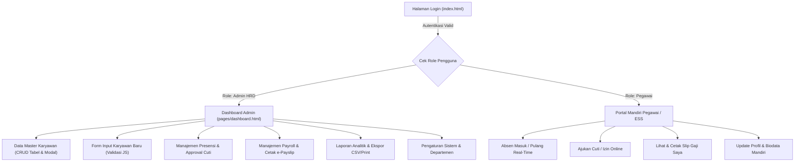
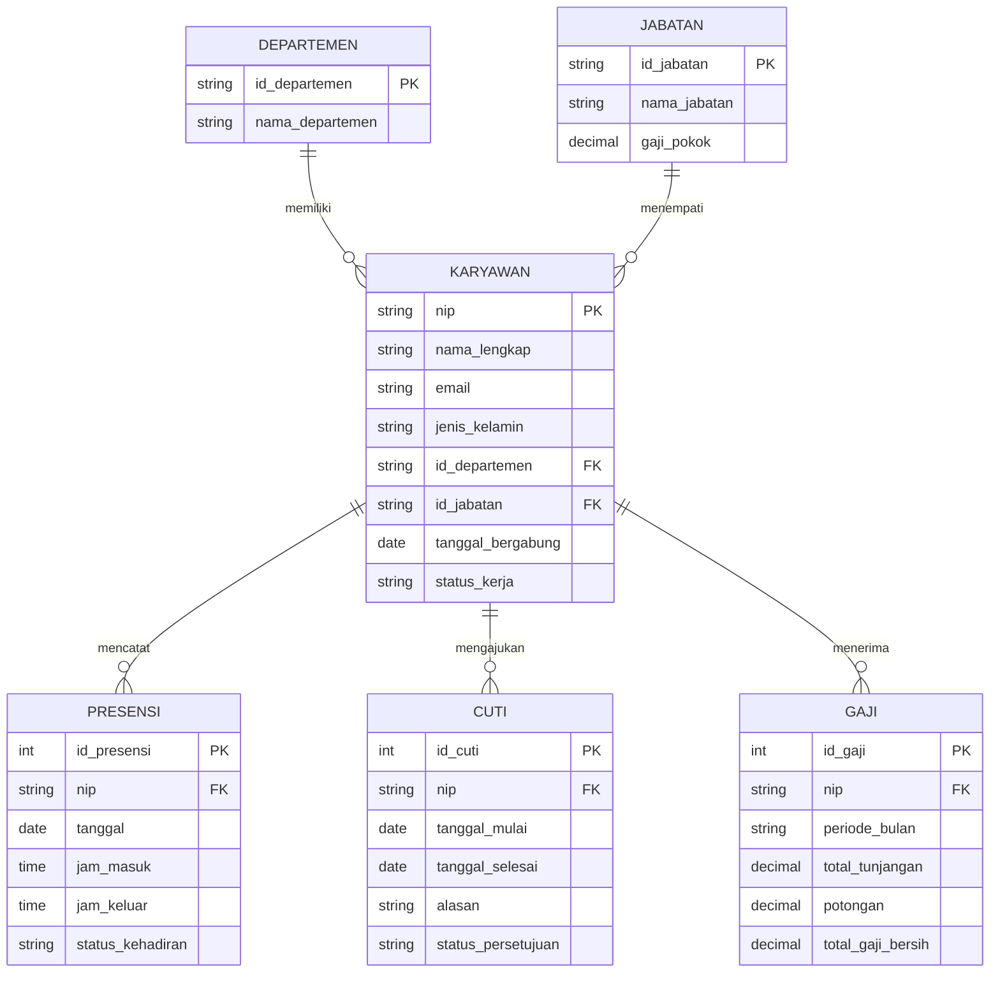
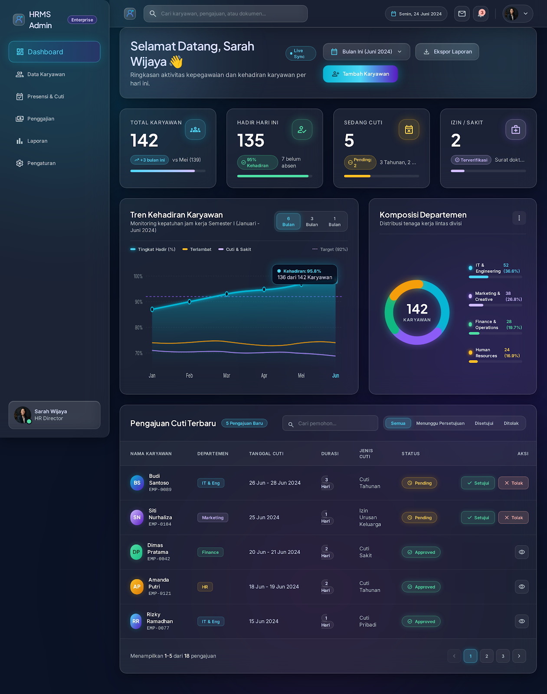
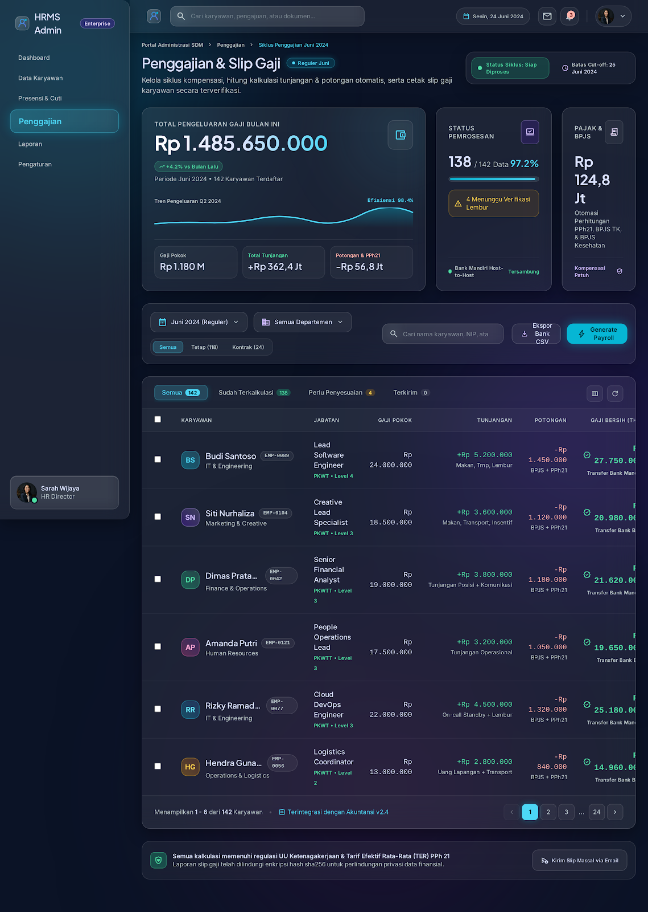
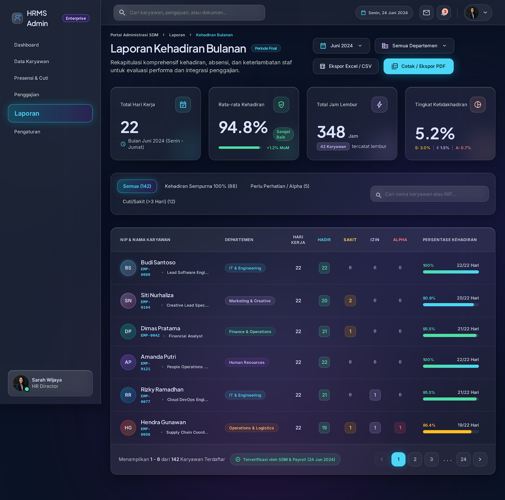
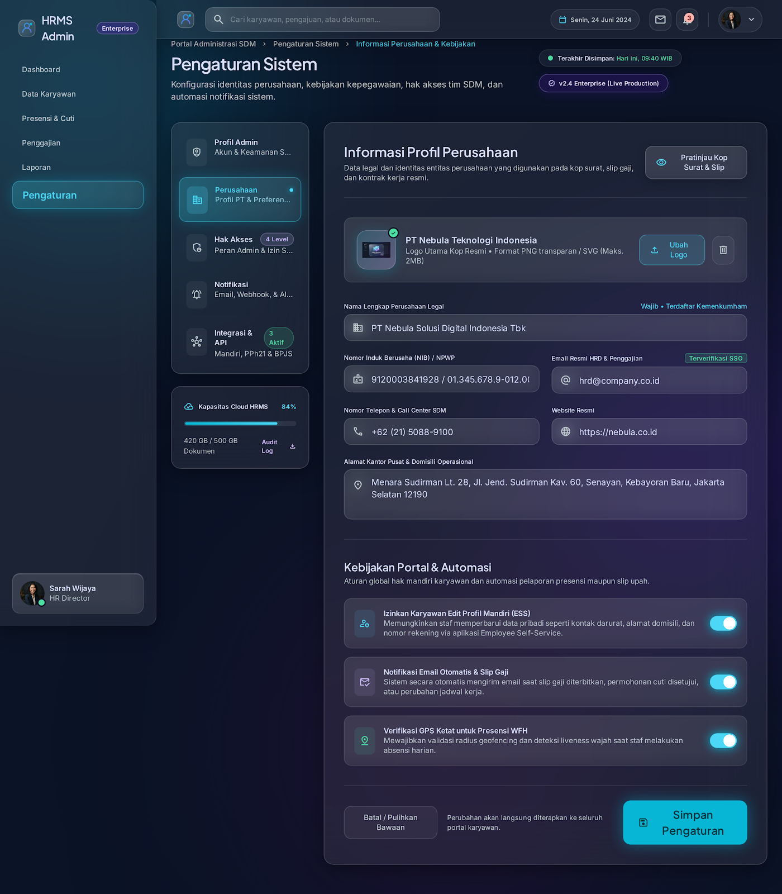

# Dokumentasi Perancangan Admin Panel HRMS (Human Resource Management System)
## PT Sawit Abadi Tbk — Enterprise HR & Plantation Portal

- **Topik Sistem Informasi:** Aplikasi Kepegawaian & SDM (HRMS - Human Resource Management System)
- **Mata Kuliah:** Pemrograman Web 2 (Client-Side Programming)
- **Konsep Visual & Arsitektur UI:** **Glassmorphism UI** (Dark Mode Enterprise)

---

## 1. Hirarki & Arsitektur Menu

```text
HRMS Enterprise — PT Sawit Abadi Tbk
├── 🔐 Autentikasi (index.html)
│   ├── Login Multi-Role (Admin HRD & Portal Mandiri Pegawai / ESS)
│   ├── Toggle Lihat/Sembunyikan Kata Sandi
│   └── Modal Pemulihan Kata Sandi (IT Helpdesk Ticket & OTP)
│
├── 📊 Dashboard (pages/dashboard.html)
│   ├── Ringkasan KPI (Total Karyawan, Presensi Hari Ini, Cuti Pending, Payroll)
│   ├── Grafik Interaktif Tren Kehadiran & Produktivitas (Filter 6 Bulan / 1 Tahun)
│   ├── Grafik Distribusi Karyawan per Departemen (Donut Chart)
│   ├── Tabel Karyawan Terbaru (Pencarian & Filter Cepat)
│   └── Panel Persetujuan Cepat Cuti & Status Server
│
├── 👥 Data Karyawan / Data Master (pages/data-master.html)
│   ├── Statistik Komposisi Karyawan (Tetap, Kontrak, Probation, Turnover)
│   ├── Tabel Master Karyawan (Pencarian Real-Time, Filter Departemen & Status)
│   ├── Modal Detail Profil Karyawan & Riwayat
│   ├── Modal Edit Data Karyawan (Update Instan)
│   └── Modal Konfirmasi Hapus Data Karyawan
│
├── 📝 Form Tambah Karyawan (pages/form.html)
│   ├── Generator NIP Otomatis (EMP-XXXX)
│   ├── Upload & Preview Foto Profil Karyawan
│   ├── Validasi Input Client-Side (Nama, Email, Telepon, Departemen, Jabatan)
│   ├── Pilihan Model Kerja Interaktif (WFO, Hybrid Flex, Full Remote)
│   └── Kalkulasi Kompensasi Gaji Pokok & Tunjangan
│
├── 📅 Presensi & Cuti (pages/presensi.html)
│   ├── Tab Log Presensi Harian & Pencatatan Presensi Manual (Modal)
│   ├── Tab Manajemen Pengajuan Cuti & Izin (Approve / Reject / Ajukan Cuti)
│   └── Tab Jadwal Shift Kerja Operasional
│
├── 💰 Penggajian / Payroll (pages/penggajian.html)
│   ├── Ringkasan Total Pengeluaran Gaji Pokok, Tunjangan, & Pajak PPh21/BPJS
│   ├── Filter Periode Bulan, Departemen, & Status Pemrosesan Payroll
│   ├── Otomasi Proses Payroll Bulanan
│   └── Modal e-Payslip (Slip Gaji Elektronik Resmi & Cetak PDF)
│
├── 📈 Laporan & Analitik (pages/laporan.html)
│   ├── KPI Rata-Rata Kehadiran, Produktivitas, Total Cuti, & Keterlambatan
│   ├── Grafik Tren Kehadiran Tahunan & Distribusi Departemen
│   ├── Tabel Rekapitulasi Kehadiran Karyawan per Periode
│   └── Fitur Cetak Laporan (Print PDF) & Ekspor CSV
│
└── ⚙️ Pengaturan Sistem & Profil (pages/pengaturan.html)
    ├── Profil Perusahaan & Upload Logo Kustom
    ├── Pengaturan Jam Kerja & Kebijakan Presensi
    ├── Manajemen Departemen (Tambah & Hapus Divisi)
    └── Manajemen Akun & Hak Akses Pengguna
```

### Alur Pengguna (User Flow Diagram)



---

## 2. Entity Relationship Diagram (ER-D) Sederhana



---

## 3. Design System (Glassmorphism Specifications)

### A. Palet Warna (Color Palette)
| Token / Elemen | Nilai Warna (HEX / RGBA) | Kegunaan |
| :--- | :--- | :--- |
| **Background Utama** | `#05050A` / `linear-gradient(135deg, #0F172A, #1E1B4B)` | Latar belakang kanvas aplikasi |
| **Glass Surface Base** | `rgba(255, 255, 255, 0.06)` s/d `rgba(255, 255, 255, 0.08)` | Permukaan kartu, tabel, sidebar, dan header |
| **Glass Border Accent** | `rgba(255, 255, 255, 0.14)` s/d `rgba(255, 255, 255, 0.18)` | Garis tepi efek kaca (*specular border*) |
| **Primary Cyan** | `#06B6D4` / `#4CD7F6` | Tombol utama, status aktif, aksen interaktif |
| **Purple Accent** | `#8B5CF6` / `#D0BCFF` | Badge departemen, grafik sekunder |
| **Success Emerald** | `#10B981` / `#4EDEA3` | Status Aktif, Hadir Tepat Waktu, Cuti Disetujui, Gaji Bersih |
| **Warning Amber** | `#F59E0B` / `#FFCF5C` | Status Cuti Pending, Perlu Penyesuaian |
| **Danger Rose** | `#EF4444` / `#FFB4AB` | Tombol Hapus, Terlambat, Potongan Pajak/BPJS |
| **Primary Text** | `#F8FAFC` / `#DAE2FD` | Judul, nilai KPI, nama karyawan |
| **Secondary Text** | `#94A3B8` / `#BCC9CD` | Label form, subjudul, informasi tambahan |

### B. Tipografi (Typography)
- **Heading & Display KPI:** `'Plus Jakarta Sans', sans-serif` (Weights: `600`, `700`, `800`)
- **Body & Navigasi UI:** `'Inter', sans-serif` (Weights: `400`, `500`, `600`, `700`)
- **Data Numerik, NIP & Mata Uang:** `'Liberation Mono', monospace`

### C. Spesifikasi Efek Glassmorphism & Komponen Reusable
- **Backdrop Blur:** `backdrop-filter: blur(12px) saturate(180%);`
- **Elevation Shadow:** `box-shadow: 0 8px 32px rgba(0, 0, 0, 0.36);`
- **Border Radius:** `16px` (Glass Card & Table Container), `12px` (Button, Input, & Dropdown), `9999px` (Status Pill / Badge).

---

## 4. Tautan Rancangan Desain (Figma & Google Stitch)

- **Link Figma Prototype & Design System:** [Buka Project Figma HRMS](https://www.figma.com/design/saKZyOWLsFdgx527WYXjjs/Untitled?node-id=0-1&t=B3OcPGO1tJEx9ZQA-1)
- **Link UI Wireframing (Google Stitch):** [Buka Project Google Stitch HRMS](https://stitch.withgoogle.com/projects/6089644355716845591)

### Preview Hasil Rancangan UI (Stitch & Figma High-Fidelity Design)

#### 1. Rancangan Halaman Dashboard (`dashboard.html`)


#### 2. Rancangan Halaman Data Master Karyawan (`data-master.html`)


#### 3. Rancangan Halaman Form Tambah Karyawan (`form.html`)


#### 4. Rancangan Halaman Manajemen Kehadiran & Cuti (`presensi.html`)


#### 5. Rancangan Halaman Penggajian / Payroll (`penggajian.html`)


#### 6. Rancangan Halaman Laporan & Analitik (`laporan.html`)


#### 7. Rancangan Halaman Pengaturan Sistem (`pengaturan.html`)

